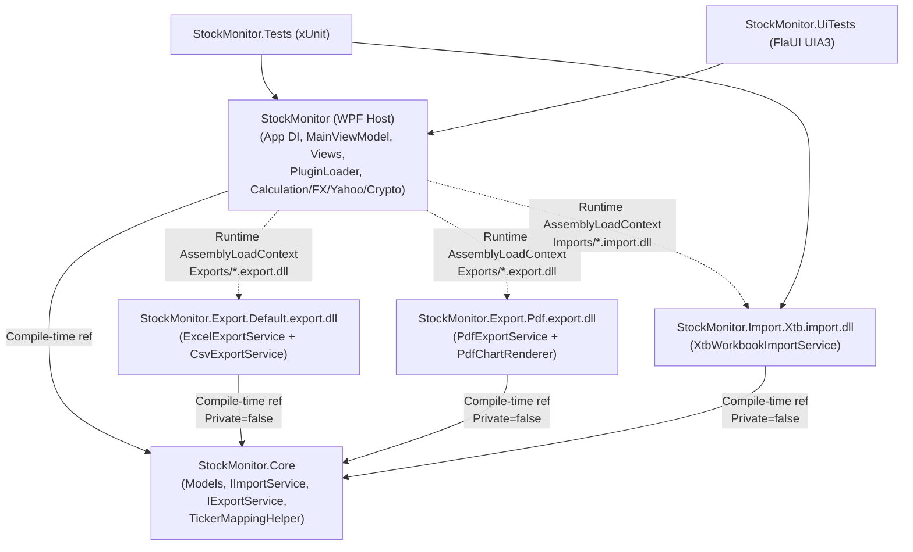

# StockMonitor

**StockMonitor** is a Windows desktop portfolio analytics application built with **.NET 10**, **WPF**, **Syncfusion Essential Studio for WPF (`31.1.17`)**, and **`CommunityToolkit.Mvvm`**. It tracks open and closed stock/ETF lots, multi-currency valuations with date-exact European Central Bank (ECB) exchange rates, live Yahoo Finance quotes and price history, dividend withholding tax rules, encrypted local JSON storage, and a runtime plugin system for broker importers (`*.import.dll`) and report exporters (`*.export.dll`).

---

## Table of Contents

- [Part 1 — User Manual](#part-1--user-manual)
  - [1. Getting Started](#1-getting-started)
  - [2. Managing Portfolio Files & Encryption](#2-managing-portfolio-files--encryption)
  - [3. Importing Broker Reports](#3-importing-broker-reports)
  - [4. Exporting Reports & Charts](#4-exporting-reports--charts)
  - [5. Live Market Data, Currencies, Language & Themes](#5-live-market-data-currencies-language--themes)
  - [6. Workspace Tabs Guide](#6-workspace-tabs-guide)
  - [7. Keyboard Shortcuts & Chart Interactions](#7-keyboard-shortcuts--chart-interactions)
- [Part 2 — Software Architecture](#part-2--software-architecture)
  - [1. Solution Map & Project Dependencies](#1-solution-map--project-dependencies)
  - [2. MVVM, DI & UI Layer](#2-mvvm-di--ui-layer)
  - [3. Plugin Architecture (`PluginLoader` & `AssemblyLoadContext`)](#3-plugin-architecture-pluginloader--assemblyloadcontext)
  - [4. Creating a Custom Import or Export Plugin](#4-creating-a-custom-import-or-export-plugin)
  - [5. Data Priority, Market APIs & Calculation Engine](#5-data-priority-market-apis--calculation-engine)
  - [6. Persistence & Document Encryption](#6-persistence--document-encryption)
  - [7. Build, Licensing & Automated Testing](#7-build-licensing--automated-testing)
  - [8. Project Evolution](#8-project-evolution)

---

# Part 1 — User Manual

## 1. Getting Started

When you launch **StockMonitor**:
- On first startup, StockMonitor loads your last opened portfolio JSON file (or initializes `%LocalAppData%\StockMonitor\portfolio.json` from the bundled seed dataset if no portfolio exists yet).
- The **top bar** gives one-click access to:
  - **File** menu (file operations, password encryption, Import plugins, Export plugins, Demo portfolio, Exit)
  - **Sync Yahoo & ECB Rates** (fetches live stock quotes, historical daily prices, and live/historical ECB exchange rates)
  - **My Currency** (`EUR`, `USD`, `CZK`, `CHF`, `GBP`)
  - **Language** (`EN` English / `SK` Slovak — updates all labels, headers, and tooltips live)
  - **Theme** (21 Syncfusion visual themes)
  - Live portfolio counters (**Account**, **Open Lots**, **Closed Lots**, **Tickers**)
- The **bottom status bar** displays the currently active JSON file path, a progress indicator during background tasks, an execution timer, and status messages.

---

## 2. Managing Portfolio Files & Encryption

All file actions live under the **File** menu:

| Action | Shortcut | Description |
|---|---|---|
| **New** | `Ctrl+N` | Creates a fresh, empty portfolio document pre-populated with default country withholding tax rules. |
| **Open...** | `Ctrl+O` | Opens any saved `.json` portfolio file. If the file is encrypted, StockMonitor prompts for its password. |
| **Demo** | — | Loads an anonymized multi-asset demo portfolio (US & EU stocks, bonds, and ETFs) as an unsaved document for exploration. |
| **Save** | `Ctrl+S` | Saves the current portfolio to disk (preserving encryption if a password is set). |
| **Save As...** | `Ctrl+Shift+S` | Saves the portfolio to a new `.json` file path. |
| **Password...** | — | Sets, changes, or removes password encryption for the current portfolio file. |
| **Exit** | `Alt+F4` | Closes the application (prompts to Save, Discard, or Cancel if there are unsaved changes). |

### Password-Protected Portfolios
- Use **File → Password...** to protect a portfolio file with a password.
- Encryption uses **AES-256-GCM** with a key derived via **PBKDF2-HMAC-SHA256**.
- Passwords are **never saved to disk** and are cleared from memory when you close the document or exit the app.
- To change or remove protection on an encrypted document, enter the current password first (leave the new password empty to save unencrypted).

---

## 3. Importing Broker Reports

Open **File → Import** to see all installed import plugins discovered automatically from the `Imports\` folder.

- **XTB Report (`.xlsx` / `.csv`)** *(built-in plugin)*:
  - Imports **Closed Positions**, **Open Positions**, and **Cash Operations** (dividends paired with withholding taxes, deposits, withdrawals, free-funds interest, and fees) from XTB xStation Excel workbooks or CSV exports.
  - Automatically populates **Dynamic Ticker Mappings** (broker ticker → Yahoo Finance symbol, country code, and currency).
- **Importing into a non-empty portfolio**:
  - StockMonitor asks whether you want to **Replace Current Content** or **Add to Current Content**.
  - Even when replacing broker-imported rows, **manual lots**, **personal comments/notes**, **manual tax overrides**, and **manual-locked ticker mappings** are preserved.

---

## 4. Exporting Reports & Charts

Open **File → Export** to see all installed export plugins discovered automatically from the `Exports\` folder:

| Export Format | Output | Contents |
|---|---|---|
| **Excel Workbook (`.xlsx`)** | Multi-sheet Excel file | 5 worksheets: **Positions**, **Dividends**, **Portfolio History**, **Dividend Tax Rules**, and a **Charts** dashboard with **4 native interactive Excel charts** (*Portfolio Value vs. Active Invested*, *Open Holdings Allocation*, *Total Profit/Loss by Ticker*, and *Annual Net Dividends*). |
| **PDF Report (`.pdf`)** | Landscape A4 PDF | **Page 1:** 2×2 vector chart dashboard (*Portfolio Value vs. Active Invested*, *Open Holdings Allocation*, *Total Profit/Loss by Ticker*, *Annual Net Dividends*). **Page 2+:** Paginated tables with repeating headers for *Positions*, *Dividends*, *Portfolio History*, and *Dividend Tax Rules*. |
| **CSV Report (`.csv`)** | UTF-8 CSV file | Complete tabular export of all position lots in both native and selected base currency. |

---

## 5. Live Market Data, Currencies, Language & Themes

- **Sync Yahoo & ECB Rates**: Click in the top menu bar to fetch:
  - Latest stock/ETF quotes and daily historical price candles from Yahoo Finance.
  - Current and transaction-date-exact exchange rates from the ECB (Frankfurter API), cached locally so offline reopening stays fast.
- **Selectable Base Currency**: Switch between `EUR`, `USD`, `CZK`, `CHF`, and `GBP` at any time. All costs, valuations, capital P/L, dividends, cash flows, summaries, and historical curves recalculate automatically.
- **Language Switching**: Toggle between **EN** (English) and **SK** (Slovak) live without restarting.
- **Visual Themes**: Choose from 21 Syncfusion themes (`Windows11Dark`, `Windows11Light`, `FluentDark`, `FluentLight`, `Material3Dark`, `Material3Light`, `Office2019*`, `VisualStudio*`, `Metro`, `Blend`, `Saffron`, `Lime`).

---

## 6. Workspace Tabs Guide

### Tab 1 — Positions (Open & Closed)
- **Top-Left Pane (`Stock Price Chart & Lot Details` / `Yahoo Finance Page`)**:
  - **Stock Price Chart**: Interactive daily close price chart for the currently selected lot with crosshair trackball, mouse-wheel zoom, X-axis drag-to-zoom, and right-click zoom Undo/Redo/Reset.
  - **Selected Lot Details Sidebar**: Edit company name, ticker, Yahoo symbol, country, currency, manual price overrides, manual dividend tax rate, and multi-line personal notes/comments.
  - **Yahoo Finance Page (Full Width)**: Embedded Chromium (**WebView2**) browser showing `https://finance.yahoo.com/quote/{Symbol}` directly inside the app, with *Reload* and *Open in External Browser* buttons.
  - Resizable horizontal and vertical splitters (`SfGridSplitter`) with one-click collapse buttons.
- **Bottom Pane (Positions Grid)**:
  - Grouped by **Company Name** with group summaries and overall table summaries, frozen leading columns, sorting, and column filtering.
  - **Inline Cell Editing**: Edit fields (company name, ticker, currency, category, open/close dates, quantity, open/close/current price, manual tax override, comment) directly inside grid cells—StockMonitor automatically recalculates affected metrics and marks manual price overrides visually.
  - **Profit Sparkline Column**: Custom high-performance zero-baseline column sparkline coloring positive returns green and negative returns red.
  - Toolbar controls for **Status Filter** (`All`, `Open Only`, `Closed Only`), live **Search**, **Expand All / Collapse All**, **Add New Position**, and **Delete Selected Position**.

### Tab 2 — Summary & Overview
- **KPI Cards**: Open Invested, Open Market Value, Capital Gain/Loss (with Closed Realized breakdown), Net Dividends (with Withholding Tax breakdown), Total Profit (with Free-Funds Interest), and Total Return % (with Cash Deposits).
- **Visual Charts**: Allocation charts by company/instrument and by country, plus aggregated per-ticker summary grid.

### Tab 3 — Dividends
- **Annual & Instrument Dividend Charts** visualizing gross/net dividend income and share breakdown.
- **Dividends Ledger**: Complete history of cash dividends (both broker-reported and Yahoo Finance fallback) with pay date, dividend per share, gross amount, tax rate %, withholding tax, net amount in base currency, linked position ID, and source indicator.

### Tab 4 — Portfolio History
- **Historical Performance Chart**: Tracks *Total Portfolio Value*, *Active Invested Capital*, and *Cumulative Net Dividends* over time with trackball tooltips, X-axis drag-to-zoom, and right-click Zoom Undo/Redo/Reset.
- **History Snapshots Table**: Date-indexed portfolio metrics including cumulative deposits, active invested capital, market value, realized capital P/L, cumulative net dividends, total value, total profit, and return %.

### Tab 5 — Tickers, Tax Rules, Cash Flow & Settings
- **Dynamic Ticker Mappings (Top-Left)**: Editable table mapping broker tickers to Yahoo Finance symbols, categories, countries, and currencies. Check **Manual Lock** to prevent future broker imports from overwriting a custom mapping.
- **Withholding Tax Rules by Country (Top-Right)**: Editable standard vs. applied treaty tax rates by country code, with Add / Delete / Reset / Save & Recalculate buttons and an automatic validation memo flagging any active portfolio tickers that need country/tax verification.
- **All Imported Cash Operations (Bottom)**: Full ledger of deposits, withdrawals, free-funds interest, dividends, withholding taxes, purchases/sales, and fees converted to your base currency on each operation's exact date.

---

## 7. Keyboard Shortcuts & Chart Interactions

| Input | Action |
|---|---|
| `Ctrl+N` | New empty portfolio |
| `Ctrl+O` | Open portfolio JSON file |
| `Ctrl+S` | Save current portfolio |
| `Ctrl+Shift+S` | Save portfolio as new file |
| `Alt+F4` | Exit application |
| **Mouse Wheel** on charts | Zoom X-axis in/out |
| **Left-Drag on X-Axis label bar** | Draw horizontal selection overlay to zoom into a specific date range |
| **Right-Click on chart** | Context menu: *Reset Zoom (100%)*, *Undo Zoom*, *Redo Zoom* |

---

# Part 2 — Software Architecture

## 1. Solution Map & Project Dependencies

The solution ([StockMonitor.slnx](StockMonitor.slnx)) consists of **7 projects**:

| Project | Target | Output | Responsibility |
|---|---|---|---|
| **StockMonitor.Core** | `net10.0` | `StockMonitor.Core.dll` | Shared domain models (`PortfolioDocument`, `PositionLot`, `DividendRecord`, `AccountCashFlowRecord`, `PortfolioHistoryPoint`, `CountryTaxRule`, `TickerMapping`, `AppSettings`), plugin contracts (`IImportService`, `IExportService`), and shared `TickerMappingHelper`. |
| **StockMonitor** | `net10.0-windows` (WPF) | `StockMonitor.exe` | Desktop host application: DI composition root (`App.xaml.cs`), `MainViewModel`, 5 WPF views, custom behaviors/controls, `PluginLoader`, market/FX/calculation/storage/crypto/localization services. |
| **StockMonitor.Export.Default** | `net10.0-windows` | `Exports\StockMonitor.Export.Default.export.dll` | Export plugin providing `ExcelExportService` (Syncfusion XlsIO + 4 native Excel charts) and `CsvExportService`. |
| **StockMonitor.Export.Pdf** | `net10.0-windows` | `Exports\StockMonitor.Export.Pdf.export.dll` | Export plugin providing `PdfExportService` and `PdfChartRenderer` (Syncfusion PDF landscape report + 2×2 vector chart dashboard). |
| **StockMonitor.Import.Xtb** | `net10.0-windows` | `Imports\StockMonitor.Import.Xtb.import.dll` | Import plugin providing `XtbWorkbookImportService` (parses XTB `.xlsx`/`.xls`/`.csv` reports via Syncfusion XlsIO). |
| **StockMonitor.Tests** | `net10.0-windows` | Unit test assembly | xUnit test suite covering calculations, crypto, storage, preferences, localization, Yahoo/FX providers (with stubbed HTTP), XTB parsing, and dynamic `PluginLoader` discovery/execution. |
| **StockMonitor.UiTests** | `net10.0-windows` | UI test assembly | FlaUI (UIA3) automated end-to-end desktop tests against an isolated `STOCKMONITOR_DATA_DIR`. |



> **Decoupled Host Compilation:** `StockMonitor.csproj` references the 3 plugin projects with `ReferenceOutputAssembly="false"` solely for MSBuild build ordering and post-build copying into `Exports\` and `Imports\`. The host application has **zero compile-time assembly references** to any concrete importer or exporter implementation.

---

## 2. MVVM, DI & UI Layer

- **Dependency Injection ([App.xaml.cs](StockMonitor/App.xaml.cs))**:
  - Uses `Microsoft.Extensions.DependencyInjection` as the single unified container.
  - Registers core singletons (`IFileDialogService`, `AppPreferencesService`, `FrankfurterFxRateProvider`, `YahooFinanceMarketDataProvider`, `PortfolioStorageService`, `PortfolioCalculationService`, `MainViewModel`), transient `MainWindow`, and dynamically discovered plugins via `PluginLoader`.
  - Global unhandled exception handlers (`DispatcherUnhandledException`, `AppDomain.UnhandledException`, `TaskScheduler.UnobservedTaskException`) write diagnostics to `%LocalAppData%\StockMonitor\crash.log` and present an actionable error dialog with an *Open Log in Explorer* button.
- **ViewModel ([MainViewModel.cs](StockMonitor/ViewModels/MainViewModel.cs))**:
  - Built on `CommunityToolkit.Mvvm` (`ObservableObject`, `[ObservableProperty]`, `[RelayCommand]`).
  - Completely decoupled from WPF windows/dialogs via `IFileDialogService` (implemented by `WpfFileDialogService`).
  - Tracks dirty state across all editable `PositionLot`, `TickerMapping`, and `CountryTaxRule` entities (`INotifyPropertyChanged`), triggering debounced inline recalculations when values are edited directly in the grid.
  - Runs all I/O, network fetches, imports, exports, and portfolio recalculations asynchronously with live elapsed-time tracking (`RunWithStatusTimerAsync`).
- **Views & Custom Behaviors**:
  - `MainWindow.xaml` hosts the `MenuAdv` bar, `TabControlExt` with 5 modular `UserControl` views (`PositionsView`, `SummaryView`, `DividendsView`, `HistoryView`, `SettingsView`), and status bar.
  - [ChartAxisDragZoomBehavior.cs](StockMonitor/Behaviors/ChartAxisDragZoomBehavior.cs): Attached behavior rendering a semi-transparent `Adorner` selection band when dragging across a chart's X-axis bar, paired with Undo/Redo zoom history stacks in `MainViewModel`.
  - [ProfitSparklineControl.cs](StockMonitor/Behaviors/ProfitSparklineControl.cs): Custom lightweight `FrameworkElement` rendering green/red zero-baseline return columns inside grid cells.
  - [MvvmBehaviors.cs](StockMonitor/Behaviors/MvvmBehaviors.cs) & [GridColumnHelp.cs](StockMonitor/Behaviors/GridColumnHelp.cs): Bindable `SfSkinManager` theming, WebView2 source binding, grid filter clearing, group expand/collapse triggers, space-grouped axis labels, and localized column header tooltips.
- **Localization ([LocalizationService.cs](StockMonitor/Services/LocalizationService.cs))**:
  - Reactive singleton indexer (`LocalizationService.Instance[key]`) backed by `Resources/Strings.resx` (EN) and `Resources/Strings.sk.resx` (SK), raising `PropertyChanged("Item[]")` on language switch.

---

## 3. Plugin Architecture (`PluginLoader` & `AssemblyLoadContext`)

Plugin discovery is handled by a single generic loader in [PluginLoader.cs](StockMonitor/Services/PluginLoader.cs) using .NET's built-in `System.Runtime.Loader.AssemblyLoadContext` and `AssemblyDependencyResolver` (no MEF or external plugin framework required):

```csharp
PluginLoader.RegisterImportPlugins(services); // scans Imports\*.import.dll -> IImportService
PluginLoader.RegisterExportPlugins(services); // scans Exports\*.export.dll -> IExportService
```

### How It Works
1. **Fast Filtered Scanning**: Only inspects files matching `*.import.dll` (in the app directory and `Imports\`) or `*.export.dll` (in the app directory and `Exports\`), skipping all Syncfusion and .NET framework assemblies at startup.
2. **Isolated Load Context with Shared Contracts**: Each plugin DLL loads in its own `PluginAssemblyLoadContext`:
   - `StockMonitor.Core`, `CommunityToolkit.Mvvm`, and `Syncfusion.*` delegate to `AssemblyLoadContext.Default`. This guarantees:
     - **Type identity** for `IImportService`, `IExportService`, and all `StockMonitor.Models` types.
     - **Unified Syncfusion licensing** — `SyncfusionLicenseProvider.RegisterLicense(...)` registered in `App.xaml.cs` automatically applies to plugins using `Syncfusion.XlsIO` or `Syncfusion.Pdf`.
   - Any **plugin-private dependencies** (e.g., a third-party CSV/PDF/broker SDK) are resolved in isolation via `AssemblyDependencyResolver` using the plugin's `.deps.json`.
3. **Unified DI Registration**: Every concrete public implementation of `TService` is registered as a singleton via `ActivatorUtilities.CreateInstance(sp, pluginType)`, so plugins work with parameterless constructors or can optionally inject host DI services.
4. **Dynamic UI Binding**: `MainViewModel` injects `IEnumerable<IImportService>` and `IEnumerable<IExportService>`, and `MainWindow.xaml` automatically populates **File → Import** and **File → Export** submenus from those collections.

---

## 4. Creating a Custom Import or Export Plugin

You can add a new broker importer (e.g., Interactive Brokers, Trading 212) or export format (e.g., JSON, HTML, Tax Statement) **without recompiling `StockMonitor`**:

1. Create a `.NET 10` class library project with `<EnableDynamicLoading>true</EnableDynamicLoading>` and an assembly name ending in `.export` or `.import`:
   ```xml
   <Project Sdk="Microsoft.NET.Sdk">
     <PropertyGroup>
       <TargetFramework>net10.0-windows</TargetFramework>
       <AssemblyName>MyBroker.import</AssemblyName>
       <EnableDynamicLoading>true</EnableDynamicLoading>
     </PropertyGroup>

     <ItemGroup>
       <ProjectReference Include="..\StockMonitor.Core\StockMonitor.Core.csproj">
         <Private>false</Private>
         <ExcludeAssets>runtime</ExcludeAssets>
       </ProjectReference>
     </ItemGroup>
   </Project>
   ```
   *(If your plugin also uses Syncfusion `31.1.17`, add `<PackageReference Include="Syncfusion.UI.WPF.NET" Version="31.1.17"><ExcludeAssets>runtime</ExcludeAssets></PackageReference>`.)*
2. Implement `IImportService` (from [IImportService.cs](StockMonitor.Core/Services/IImportService.cs)) or `IExportService` (from [IExportService.cs](StockMonitor.Core/Services/IExportService.cs)).
3. Copy the compiled `MyBroker.import.dll` (and its `.deps.json` plus any private dependencies) into `Imports\` (or `Exports\` for `*.export.dll`) next to `StockMonitor.exe`.
4. Launch StockMonitor—your plugin appears automatically in **File → Import** or **File → Export**.

---

## 5. Data Priority, Market APIs & Calculation Engine

### Data Priority Hierarchy
1. **Manual User Overrides** (manual open/close/current prices, manual dividend tax rates, locked ticker mappings, personal comments) always take highest priority.
2. **Broker-Imported Records** (executed trade prices, broker purchase/sale values, recorded dividends and withholding taxes) take priority over API estimates.
3. **Live Market & FX APIs** fill live quotes, historical OHLCV price candles, current and historical FX rates, and fallback dividends.

### Core Services
- **[YahooFinanceMarketDataProvider.cs](StockMonitor/Services/YahooFinanceMarketDataProvider.cs)**: Queries Yahoo Finance chart endpoints (`query1.finance.yahoo.com/v8/finance/chart/{symbol}`) for live quotes, daily OHLCV history, and dividend events, with local JSON caching.
- **[FrankfurterFxRateProvider.cs](StockMonitor/Services/FrankfurterFxRateProvider.cs)**: Fetches live and transaction-date-exact ECB exchange rates from `api.frankfurter.dev/v1/`, persisting fetched date tables to `fx_rates_by_date.json` (no hardcoded FX tables).
- **[PortfolioCalculationService.cs](StockMonitor/Services/PortfolioCalculationService.cs)**: Computes native and base-currency costs, market values, realized/unrealized capital P/L, dividend allocations to active lot holding intervals, withholding tax rules, 30-day profit sparklines, ticker/country summaries, and historical portfolio valuation curves.

---

## 6. Persistence & Document Encryption

- **[PortfolioStorageService.cs](StockMonitor/Services/PortfolioStorageService.cs)**: Async JSON read/write with `SemaphoreSlim` concurrency protection, automatic seeding from `Data\xtb_seed.csv` via the discovered `"xtb"` `IImportService`, and `STOCKMONITOR_DATA_DIR` environment variable override for isolated test runs.
- **[AppPreferencesService.cs](StockMonitor/Services/AppPreferencesService.cs)**: Persists last opened file path and UI shell preferences in `%LocalAppData%\StockMonitor\`.
- **[DocumentCryptoService.cs](StockMonitor/Services/DocumentCryptoService.cs)**:
  - Wraps serialized JSON in an authenticated envelope encrypted with **AES-256-GCM** (random 12-byte nonce + 16-byte authentication tag).
  - Derives 256-bit keys via **PBKDF2-HMAC-SHA256** (`Rfc2898DeriveBytes.Pbkdf2`) with random 16-byte salt.
  - Holds derived key bytes inside a disposable `DocumentEncryptionKey` (never keeping plaintext passwords as immutable strings) and zeroes key memory via `CryptographicOperations.ZeroMemory` on disposal and window close.

---

## 7. Build, Licensing & Automated Testing

### Prerequisites
- **.NET 10 SDK** (`net10.0` / `net10.0-windows`) on Windows.
- **Syncfusion Essential Studio for WPF `31.1.17`** (installed locally in `C:\Program Files (x86)\Syncfusion\Essential Studio\WPF\31.1.17\ToolboxNuGetPackages` or available via NuGet).
- **WebView2 Runtime** (pre-installed on Windows 11 / modern Windows 10) for the embedded Yahoo Finance browser tab.

### Syncfusion Licensing
- Set the `SYNCFUSION_LICENSE_KEY` environment variable before running or building.
- `App.xaml.cs` resolves the key from `SYNCFUSION_LICENSE_KEY` (or optional build-time `AssemblyMetadataAttribute` injected by `StockMonitor.csproj` when `SYNCFUSION_LICENSE_KEY` is present during build). License keys are never hardcoded or committed to source control.

### Building the Solution
```powershell
# Restore & build full solution (all 7 projects)
dotnet build StockMonitor.slnx

# Offline build using local caches only
dotnet build StockMonitor.slnx --no-restore
```

> `Directory.Build.props` sets `<MSBuildEnableWorkloadResolver>false</MSBuildEnableWorkloadResolver>` to prevent unrelated Mono/MAUI workload resolver errors on WPF-only machines.

### Running Automated Tests
```powershell
# Run all xUnit unit & plugin tests (56 tests, zero live network calls)
dotnet test StockMonitor.Tests\StockMonitor.Tests.csproj

# Run FlaUI (UIA3) desktop UI end-to-end tests (uses isolated temp STOCKMONITOR_DATA_DIR)
dotnet test StockMonitor.UiTests\StockMonitor.UiTests.csproj
```

---

## 8. Project Evolution

Key milestones from the repository history:
1. **Initial Foundation** (`a221a17`, `ef21707`): Core 5-tab WPF portfolio tracker, XTB workbook/CSV ingestion, Yahoo Finance quotes, Frankfurter ECB FX engine, and dividend tax rules.
2. **Testing & Recalculation Reliability** (`5c5c33a`, `4f243e4`): Added comprehensive xUnit backend suite and FlaUI UIA3 end-to-end desktop test suite; fixed auto-recalculation edge cases.
3. **Encrypted Portable Documents** (`6ebc5f7`): Added multi-file `New` / `Open` / `Save` / `Save As` / `Demo` workflows with AES-256-GCM + PBKDF2 password encryption.
4. **Menu Polish, Inline Editing & Tax Rules** (`6b6fd21`, `e3710ea`, `54b0c37`, `0d21edc`): Moved actions to top `MenuAdv` bar, enabled direct inline grid cell editing with live recalculation, and enhanced country tax rule management and validation memos.
5. **Visual & Chart Upgrades** (`541428e`, `63f6b5e`): Added X-axis drag-to-zoom with Undo/Redo zoom history, improved chart tooltips/formatting, and introduced the custom green/red zero-baseline `ProfitSparklineControl`.
6. **NuGet Migration & Documentation** (`a36ada9`, `68f3964`): Standardized Syncfusion `31.1.17` NuGet package references and XML API documentation across projects.
7. **Modular Plugin Architecture & Chart Exports** (`01de578`, `37f4fa0` and current): Extracted `StockMonitor.Core`, built the unified `AssemblyLoadContext`-based `PluginLoader`, moved Excel/CSV (`StockMonitor.Export.Default.export.dll`), PDF (`StockMonitor.Export.Pdf.export.dll`), and XTB import (`StockMonitor.Import.Xtb.import.dll`) into independent plugins, added native Excel charts and a 2×2 vector PDF chart dashboard, and generalized UI menus (`File → Import` / `File → Export`) beyond XTB.
